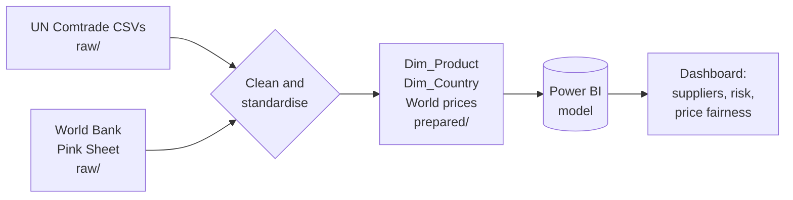

<div align="center">
# 🇹🇳 Tunisia Food Import Dependency
 
**Which countries supply Tunisia's strategic imports, how concentrated is that supply, and are the prices fair?**
 


 
**Jump to:**
[📌 About](#-about) ·
[📊 Findings](#-key-findings) ·
[🌾 Products](#-products-covered) ·
[🗂 Data](#-data) ·
[🔄 Pipeline](#-pipeline) ·
[⚠️ Limits](#️-limitations) ·
[👥 Authors](#-authors)
 
</div>
---
 
## 📌 About
 
Analysis of Tunisia's imports of strategic food and health products from **2015 to 2024**: which countries supply them, how concentrated that supply is, and how the prices Tunisia paid compare with world benchmark prices.
 
> 💡 **Tip:** sections marked with ▶ are collapsible. Click them to expand.
 
---
 
## 📊 Key Findings
 
<details open>
<summary><b>▶ Headline results</b></summary>
<br>
| Theme | Finding |
|---|---|
| ⚫ **Black Sea dependence** | Share rose from **33% (2015)** to **65% (2024)** |
| 💥 **2022 crisis** | Import spending went from ~**$1.6B (2019)** to **$2.7B (2023)** |
| 🔁 **Substitution** | **Bulgaria** became top soft-wheat supplier in 2022-23 |
| 🎯 **Single supplier** | **Soybean meal** came almost entirely from **Argentina** |
| 💰 **Price check** | Most products cost **1.0-1.2x** world price. In 2024: **rice 2.1x**, **sugar 2.0x**, **palm oil 1.45x** |
 
</details>
<details>
<summary><b>▶ How the price ratio is calculated</b></summary>
<br>
```
Price ratio = (Import value ÷ Import weight) ÷ World benchmark price
```
 
Import values include freight and insurance, so a ratio slightly above 1.0 is normal.
 
</details>
---
 
## 🌾 Products Covered
 
<details open>
<summary><b>▶ 🌾 Cereals (5)</b></summary>
<br>
| HS code | Product | World Bank benchmark |
|---|---|---|
| 100119 | Durum wheat | Wheat, US HRW (proxy) |
| 100199 | Soft wheat | Wheat, US SRW |
| 1003 | Barley | Barley (series ends Sep 2020) |
| 1005 | Maize | Maize |
| 1006 | Rice | Rice, Thai 5% |
 
</details>
<details>
<summary><b>▶ 🌱 Oilseeds & feed (2)</b></summary>
<br>
| HS code | Product | World Bank benchmark |
|---|---|---|
| 1201 | Soybeans | Soybeans |
| 2304 | Soybean meal | Soybean meal |
 
</details>
<details>
<summary><b>▶ 🛢 Vegetable oils (3)</b></summary>
<br>
| HS code | Product | World Bank benchmark |
|---|---|---|
| 1507 | Soybean oil | Soybean oil |
| 1511 | Palm oil | Palm oil |
| 1512 | Sunflower oil | Sunflower oil |
 
</details>
<details>
<summary><b>▶ 🍬 Sugar, 🥛 Dairy, 💊 Health (3)</b></summary>
<br>
| HS code | Product | Category | World Bank benchmark |
|---|---|---|---|
| 1701 | Sugar | Sugar | Sugar, world (raw) |
| 0402 | Milk powder | Dairy | none |
| 3004 | Medicines | Health | none |
 
</details>
---
 
## 🗂 Data
 
<details open>
<summary><b>▶ 📥 raw/ (original downloads)</b></summary>
<br>
| File | Description |
|---|---|
| `UNComtrade_Tunisia_Imports_5products_2015-2024.csv` | Tunisia-reported annual imports by partner (UN Comtrade) |
| `UNComtrade_Tunisia_Imports_8products_2015-2024.csv` | Tunisia-reported annual imports by partner (UN Comtrade) |
| `NOT_IN_MODEL_SupplierReported_2024-2025_*.csv` | Partner-reported exports to Tunisia, kept out of the model |
| `CMO-Historical-Data-Monthly.xlsx` | World Bank Commodity Price Data (Pink Sheet), monthly |
 
</details>
<details open>
<summary><b>▶ ✅ prepared/ (model-ready tables)</b></summary>
<br>
| File | Description |
|---|---|
| `Dim_Product.csv` | Product dimension (HS code, category, benchmark) |
| `Dim_Country.csv` | Partner dimension (ISO, region, EU, AfCFTA, Black Sea, supplier group) |
| `AnswerKey_WorldPrice_long.csv` | World Bank monthly prices in long format (USD per tonne) |
 
</details>
**Supplier groups:** `EU` · `Black Sea` · `Americas` · `Africa & Middle East` · `Other` · `Unspecified`
 
**Sources:**
[UN Comtrade Database](https://comtradeplus.un.org/) ·
[World Bank Pink Sheet](https://www.worldbank.org/en/research/commodity-markets)
 
---
 
## 🔄 Pipeline
 

 
**Project checklist**
 
- [x] Collect UN Comtrade imports (2015-2024)
- [x] Collect World Bank monthly prices
- [x] Build product and country dimensions
- [ ] Build the Power BI data model and measures
- [ ] Design the dashboard pages
- [ ] Write the process document
> Edit the checklist to match your real progress. GitHub renders `[x]` as ticked boxes.
 
---
 
## ⚠️ Limitations
 
<details>
<summary><b>▶ Click to expand</b></summary>
<br>
- Tunisia's data ends in **2024**; supplier-reported 2025 data is incomplete and kept out of the model
- Import data is **yearly**, not monthly
- **2024 weights** missing for maize and medicines
- **Barley** has no world price after Sep 2020
- **Durum wheat** uses a proxy price
- **Milk powder and medicines** have no benchmark
</details>
---
 
## 👥 Authors
 
<table>
<tr>
<td align="center"><b>Hiba Chaabouni</b><br><sub>Business Analytics (major) and IT (minor)<br>Tunis Business School</sub><br><a href="https://github.com/hiba-chaabouni">GitHub</a></td>
<td align="center"><b>Ghada Ben Amira</b><br><sub>Business Analytics (major) and IT (minor)<br>Tunis Business School</sub><br><a href="https://github.com/ghadabenamira">GitHub</a></td>
</tr>
</table>
 
